<div align="center">
<p align="center">
  <picture>
    <source media="(prefers-color-scheme: dark)" srcset="assets/watchman-logo-dark.svg">
    <source media="(prefers-color-scheme: light)" srcset="assets/watchman-logo-light.svg">
    
  </picture>
</p>
</div>

<div align="center">

  

</div>

<h1 align="center">Watchman Harness</h1>

<p align="center">
  <strong>A harness for AI coding agents, by Incord AI.</strong>
</p>

<p align="center">
  <a href="https://github.com/incordai"></a>
  <a href="https://x.com/incordai"></a>
  <a href="https://www.linkedin.com/company/incordai"></a>
  <a href="https://www.youtube.com/@incordai"></a>
</p>

Works with your own subscriptions on Claude Code, Codex, Cursor, Grok Build, OpenCode, Antigravity, Pi, omp, fx, Incord Code and Hermes. If they're installed and logged in, Watchman can run them. Tabs are sessions; chats, companies and their agents have pages of their own. The composer is the input. Watchman does not sell tokens.

Under it runs **Inmem**, Incord's memory engine: it remembers every session, guards what agents do, and runs the local models for search, speech, voice and text recognition. Everything runs on your computer, and nothing is paid per use.

## Install

> Install and log in to at least one agent first:
>
> - [Claude Code](https://claude.com/product/claude-code) - `claude auth login`
> - [Codex](https://developers.openai.com/codex/cli) - `codex login`
> - [Cursor CLI](https://cursor.com/cli) - `agent login`
> - [Grok Build](https://docs.x.ai/build/overview) - `curl -fsSL https://x.ai/cli/install.sh | bash` then `grok login`
> - [OpenCode](https://opencode.ai) - `opencode auth login`
> - [Antigravity](https://antigravity.google/docs/cli-install) (macOS/Linux) - `curl -fsSL https://antigravity.google/cli/install.sh | bash`, then run `agy` once to sign in
> - [Pi](https://pi.dev/) - `npm install -g @earendil-works/pi-coding-agent`
> - [omp](https://omp.sh) - `curl -fsSL https://omp.sh/install | sh`
> - [fx](https://fx.sh) - `curl -fsSL https://fx.sh/setup.sh | bash` then `fx login`
> - [Hermes Agent](https://github.com/NousResearch/hermes-agent) - macOS/Linux: `curl -fsSL https://hermes-agent.nousresearch.com/install.sh | bash`; Windows PowerShell: `iex (irm https://hermes-agent.nousresearch.com/install.ps1)`; then run `hermes model`

No releases are published yet: Watchman is being tested. Build it from source (below) on Windows, macOS or Linux. Once releases are out, Watchman updates itself.

Phone: open [watchman.incord.ai](https://watchman.incord.ai) and pair it from Watchman's **Settings › Phones & devices**, with a QR code or a code, on the same network or through the relay.

### First start

The first start downloads the local models (about 3.1 GB) and sets up Inmem. A small terminal under the progress ring shows each step: the engine, each model (search, speech, voice, text recognition, the local language model) and then every memory API answering before the app opens. It needs the internet for the downloads; without it, it says so and goes on by itself when the connection is back. A download that stops part-way offers **Restart installation**. Later starts only check that everything answers.

## Voice mode

Talk to your agents hands-free.

- **Speak, it types.** Your words go into the composer as you speak, transcribed on your computer. Turn on **Send after a pause** (off by default; 1, 2, 3 or 5 seconds) to send on its own, or say "send". It never sends while you are still talking, while your words are still being transcribed, or while the voice is speaking; anything you say meanwhile is kept and sent after.
- **Voice commands**, each with several phrasings: stop or start listening, quiet, sleep and wake, end voice mode, goodbye, chat mode (to the `/btw` side thread) and work mode. Approve and deny take exact phrases only. Other commands also match close pronunciations, for accents; **Teach your voice** records three takes of a command so it learns how you say it.
- **Clean input.** A voice detector cuts at your pauses, the character's own voice is never picked up again, and noise and filler words are dropped.
- **Read aloud.** Replies, notifications and approval cards, in the engine's voice or your system's. Dictation in 12 languages.
- **A character that works with you.** Rin, a 3D character, greets you ("Hi", or "Welcome back"), then acts out what the agent is doing: thinking at a desk while it reads, typing at a laptop while it edits, a laptop on her lap while tests run, a phone while it browses, waiting on the floor while it queues, a cheer when tests pass, a nod when you approve. Four sizes, extra large by default. Add your own `.vrm` characters and `.vrma` animations, or download more characters from the gallery; each download is checked against the gallery's list before use.

Pets (Ravi, and more from the pet gallery) keep you company in the terminal and the floating bar.

## Context that is never lost

- **The cache, watched.** Each session shows whether its prompt cache is warm or cold and how long it has left. A cold cache on a long context warns before sending; sending anyway starts a fresh session that carries the work over.
- **Compaction that pays for itself.** Between turns Watchman compacts only when the context is nearly full, or when compacting saves more than it costs within a few requests (cache reads are a tenth of the price of new input). Compaction runs in the background; a message you send meanwhile waits its turn.
- **Before the cache goes cold** (Settings › General): hand off and clear, compact, or do nothing.
- **Handoffs through Inmem.** Switching agent or model, starting a new session from a turn, or clearing the cache: the outgoing agent writes a handoff, and the next one starts from Inmem's session record, with the project's facts, topics and open items.

## Memory and Inmem

Watchman bundles Inmem and runs it on `127.0.0.1:9180`. On first start it installs it as a service of your OS (a scheduled task on Windows, a LaunchAgent on macOS, a systemd unit on Linux), and wires every agent it finds so they share one memory:

- **Memory that fills itself.** Every session and every code edit is captured as it happens, filed by project, and handed back when it is needed. No "remember this".
- **Guards and review.** Rules stop an agent mid-action before a bad call runs; the auditor reviews what an agent edited; the proxy answers permission requests the way you would, or asks you.
- **One heavy job at a time.** Builds and test runs from every agent wait in one queue, so they never fight over the machine.
- **Code understanding.** A code index for 11 languages that agents query instead of reading whole folders.

See the [Inmem repository](https://github.com/incordai/Inmem) for the engine itself.

## Local models, free

Every model runs on your computer. They download once, from Incord, and nothing is paid per use.

| Model | What for | Download |
|---|---|---|
| Search (Incord-RAG: embedder and reranker) | Finding memories and code by meaning | 692 MB |
| Speech, Fast (Incord-STT-Fast) | Speech to text in voice mode | 434 MB |
| Speech, Small (Incord-STT-Small), optional | More languages | 249 MB |
| Voice (Incord-TTS) | Reading replies aloud | 332 MB |
| Text recognition (Incord-OCR) | Reading text in images | 27 MB |
| Mini (Incord-Mini) | Background jobs such as session titles | 1.64 GB |

The Mini model needs at least 10 GB of memory. On a smaller computer it is not downloaded or shown, and background jobs are written by the agent you already use, on its cheapest model at low effort. Choose the speech model (Fast, Small or both) in **Settings › Local models**.

Optional and outside this: cloud memory sync and cloud boxes need a memory plan, and Chat research can use a paid search provider with your own key (it searches locally by default).

## Agents and background jobs

- Permission modes: Supervised, Auto-accept edits, Auto, Full access. Proxy modes: Off, Recommend, Decide.
- Sub-agents per agent, with their own model; `/btw` side questions on a cheap model at low effort.
- Background jobs: session titles, the code auditor and the proxy, each in **Settings › Background jobs**, showing what runs them.
- Terminals, a browser, notes, an Inbox for GitHub, GitLab, Linear and Jira, skills and plugins, companies, and team sync.

## Some notes

This is very early and you should expect bugs.

### Worktrees

Several agents can work on the same project at once without touching each other's files. An agent working alone edits the project folder directly. When you start another agent while one is already working (or waiting on you) in the project folder, the new one gets its own worktree when you send its first message: a separate checkout in `<project>-worktrees/` on its own `mc/…` branch, so the two never edit the same files. To keep it in the project folder anyway, pick "Current checkout" in the composer before sending, or turn off **Settings → Worktrees → A second agent gets its own worktree**.

You can watch the work as it happens. While an agent is working or waiting on you, its worktree appears as a card under the project in the left rail. Every worktree also has a card in the Worktrees section of the Sessions tab and the Changes panel. A card shows the branch, the lines changed, and each agent working there: its provider, what it is doing, how long it has been at it, and the files it has edited. A pulsing cursor marks the file it is writing now. Click an agent to open its conversation.

When an agent is done, finish its worktree from its card:

- **Merge** commits any uncommitted work, titled after the conversations that did it. Your Incord proxy then decides whether it should go in, the same way it answers permission requests in Auto mode. It judges from this project's brief, your standing rules, and how you decided before. Watchman hands it the evidence:
  - what the conversations asked for;
  - a dry-run merge that touches nothing;
  - the files changed;
  - which of those files other agents are changing right now;
  - the diff.
- **When the proxy decides:**
  - If it approves, the branch is merged into the branch your main checkout has out and the worktree is removed. Only the exact commit it reviewed is merged.
  - If it says not yet, its reason shows on the card, and **Merge anyway** lets you overrule it.
  - If it isn't sure, it passes the decision to you with its explanation.
  - If no proxy can answer (the memory engine isn't running), Watchman asks you in the app. Nothing merges on its own.
  - If the dry run finds both sides changed the same file, nothing is merged and Watchman names the files so you can resolve them in the worktree first.
- **Discard** asks first, then removes the worktree and its uncommitted changes. Work already committed stays on its branch.

Both keep the branch and the conversations, and are off while an agent there is still working. Git needs your name and email (`git config --global user.name` and `user.email`) before Merge can commit.

Finished worktrees also clean themselves up: Watchman removes an agent's worktree once its work is in the branch your main checkout has out (merged, squashed or cherry-picked), nothing is uncommitted, and no conversation that isn't archived still uses it. Worktrees another agent tool left in the project's `.claude/worktrees/` folder go the same way once Git has not touched them for two hours, since Watchman cannot see that tool's agents. Before removing a worktree, Watchman unlinks any junction or symlink in it that Git does not track, so a shared `node_modules` it points at is never emptied. Branches are always kept. It checks your recent projects shortly after launch, every ten minutes, and when the window regains focus. Turn this off with **Settings → Worktrees → Remove finished worktrees**.

### Agent access to Watchman

Every agent Watchman runs can use its terminals (open, send, key, read, list) and its browser (open, read, click, type, snapshot, pick) during its turn.

Type `/operator` at the start of a composer message to give that thread access to the rest of Watchman. For example, `/operator start two Codex sessions: one to inspect the API and one to review the UI`, or `/operator list my notes`. The slash picker also offers this command. The transcript shows only the request text in a translucent amber bubble; Watchman removes the command from the request sent to the agent and supplies the local `app` CLI path and instructions on that turn. Later turns in the same thread can use the CLI without repeating `/operator`; other threads get only the terminal and browser tools. The CLI can act only during an active agent turn. The agent can run the shown `app --help` command for the exact JSON input fields.

- `models.list` shows available providers, models, settings, and permission modes.
- `sessions.start` opens a tab in the current project with a prompt. Set `placement: "right"` or `placement: "down"` to split the calling session's pane instead; `besideSessionId` selects another visible session pane in the project. Reuse the returned session ID as the next `besideSessionId` to build nested layouts. By default it submits the prompt; set `draft: true` to save it unsent without starting an agent turn. It accepts a provider, model, effort or other model settings, permission mode, and current checkout or new worktree choice. Omit `runtimeMode` to inherit the calling session's permission mode, or set it explicitly to override. It returns the new session ID as soon as the pane and prompt are accepted, so the agent can move it into a folder immediately.
- `worktrees.list` and `worktrees.create` list the project's checkouts and create a worktree on a named new or existing local branch; pass its path to `sessions.start` as `worktreeCwd`.
- `sessions.list` shows project sessions. `sessions.read` returns up to three recent user/assistant exchanges, with a cursor for older exchanges and a per-message character cap. `sessions.send` submits a follow-up to an idle session, while `sessions.draft` saves an unsent message for the user to review. `folders.list` and `folders.move` organize project sessions in sidebar folders, including a new folder.
- `notes.list` returns titles and short previews; `notes.read` returns one full note by ID; `notes.write` saves one.

Orchestration workers keep their existing scoped `control` workflow and do not receive this app access.

Small, focused pull requests are welcome. Anything large is worth an issue first - see [CONTRIBUTING.md](CONTRIBUTING.md).

## Build from source

Supports macOS, Linux, and Windows.

Need Node.js 20+ and a current stable Rust toolchain. On Linux, ensure standard Tauri prerequisites are installed (e.g. `libwebkit2gtk-4.1-dev`, `libgtk-3-dev`, `libsoup-3.0-dev`, `libjavascriptcoregtk-4.1-dev`). On Windows, the installer bootstraps the [WebView2](https://developer.microsoft.com/microsoft-edge/webview2/) runtime when it is missing.

```bash
npm install
npm run tauri dev
```

### macOS packages

```bash
npm ci
npm run build:macos
```

The macOS build emits the app and a disk image under `target/release/bundle/`.

### Ubuntu / Debian packages

On an Ubuntu/Debian workstation, the repository can install the native Tauri prerequisites and build distributable Linux packages directly:

```bash
npm run setup:linux:deb
npm ci
npm run build:linux
```

The Linux build emits `.deb` and AppImage bundles under `target/release/bundle/`.
Tauri loads `src-tauri/tauri.linux.conf.json` automatically for Linux development and builds.

### Fedora / Enterprise Linux packages

On Fedora, or on an Enterprise Linux 10 system (registered RHEL, Rocky, Alma, CentOS Stream, Oracle), install an `.rpm` you built (see below). Enterprise Linux needs EPEL first, because `webkit2gtk4.1` is an EPEL package there — CRB is not needed to run Watchman. On Oracle Linux 10, `epel-release` does not enable `ol10_developer_EPEL`, which is the repository that provides that package. Enable it before installing the rpm:

```bash
# Enterprise Linux 10 only; skip on Fedora.
sudo dnf install -y epel-release   # RHEL: sudo dnf install -y https://dl.fedoraproject.org/pub/epel/epel-release-latest-10.noarch.rpm
# Oracle Linux 10, instead of epel-release:
# sudo dnf install -y oracle-epel-release-el10 dnf-plugins-core
# sudo dnf config-manager --set-enabled ol10_developer_EPEL
sudo dnf install ./Watchman-*.rpm
```

The `.rpm` declares its own runtime dependencies, so `dnf` pulls the WebKitGTK stack for you. Build it on Enterprise Linux 10 so it loads on both Fedora and EL 10. Building natively links the system WebKitGTK instead of the Ubuntu-built libraries shipped in the AppImage, which avoids graphics issues (e.g. `Could not create default EGL display`) on newer Mesa/Wayland systems.

To build it yourself instead — which also enables EPEL 10 and CRB automatically, since the -devel packages need CRB:

```bash
npm run setup:linux:fedora
npm ci
npm run build:fedora
```

That emits a `.rpm` under `target/release/bundle/rpm/`, installable with `sudo dnf install ./target/release/bundle/rpm/Watchman-*.rpm`. EL 9 and older are unsupported (`webkit2gtk4.1-devel` only exists in EPEL 10).

### Troubleshooting on Fedora / Wayland

The portable AppImage bundles Ubuntu-built Wayland libraries that can fail against newer Mesa drivers: the app aborts at startup with `Could not create default EGL display: EGL_BAD_PARAMETER`, or opens a blank window. The native `.rpm` above links the system WebKitGTK stack and does not have this problem — prefer it on Fedora.

### Windows packages

```bash
npm ci
npm run build:windows
```

The Windows build emits an NSIS installer under `target/release/bundle/nsis/`.
Tauri loads `src-tauri/tauri.windows.conf.json` automatically for Windows development and builds.

## Contributors

<a href="https://github.com/incordai/Watchman/graphs/contributors">
  
</a>


## Star History

<a href="https://www.star-history.com/?repos=incordai%2Finbrowse%2Cincordai%2Fwatchman&type=timeline&legend=top-left">
 <picture>
   <source media="(prefers-color-scheme: dark)" srcset="https://api.star-history.com/chart?repos=incordai/inbrowse%2Cincordai/watchman&type=date&theme=dark&legend=top-left" />
   <source media="(prefers-color-scheme: light)" srcset="https://api.star-history.com/chart?repos=incordai/inbrowse%2Cincordai/watchman&type=date&legend=top-left" />
   
 </picture>
</a>

## Credits

Watchman stands on the work of these people and teams. Thank you, all of you.

| Project | By | In Watchman | Licence |
|---|---|---|---|
| [MonoCode](https://github.com/hardbeat920/monocode) | Nick and [its contributors](https://github.com/hardbeat920/monocode/graphs/contributors) | Where Watchman began: its design, and the code Watchman forked from MonoCode v0.4.2, whose history is kept in this repository | MIT |
| [SenseVoice-small](https://github.com/FunAudioLLM/SenseVoice) | FunAudioLLM, Tongyi Lab, Alibaba Group | Incord-STT-Fast: speech to text | [FunASR Model Licence v1.1](https://github.com/modelscope/FunASR/blob/main/MODEL_LICENSE) |
| [Whisper small](https://github.com/openai/whisper) | OpenAI | Incord-STT-Small: speech to text in many languages | MIT |
| [Kokoro-82M](https://huggingface.co/hexgrad/Kokoro-82M) and [misaki](https://github.com/hexgrad/misaki) | hexgrad | Incord-TTS: the voice, and its English pronunciation rules | Apache 2.0 |
| [PP-OCRv6 small](https://huggingface.co/PaddlePaddle/PP-OCRv6_small_det_safetensors) | PaddlePaddle | Incord-OCR: reading text in images | Apache 2.0 |
| [Qwen3-Embedding-0.6B](https://huggingface.co/Qwen/Qwen3-Embedding-0.6B) and [Qwen3-Reranker-0.6B](https://huggingface.co/Qwen/Qwen3-Reranker-0.6B) | The Qwen team, Alibaba Group | Incord-RAG: memory search | Apache 2.0 |
| [MiniCPM5-2B](https://huggingface.co/openbmb/MiniCPM5-2B) | OpenBMB | Incord-Mini: the local language model | Apache 2.0 |

Watchman and Inmem also use many open-source libraries, each under its own licence, listed in their `Cargo.toml` and `package.json`. The full notices, with the exact model versions, are in [NOTICE](NOTICE).

## License

Watchman is source-available under the [Apache License 2.0 with the Commons Clause](LICENSE), © 2026 Incord AI. You may use, change and share it, including inside your company; you may not sell it, or a product or service whose value comes mainly from it, without a commercial licence from Incord. Because of that condition it is not called open source. The parts that come from MonoCode keep their original MIT notice, in [LICENSE](LICENSE).

The memory engine Watchman runs, Inmem, is licensed separately under the Business Source License 1.1. Provider names and logos are trademarks of their owners - see [NOTICE](NOTICE).
